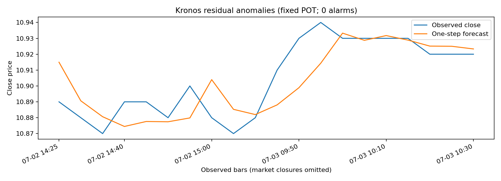

# 异常检测验证记录

验证日期：2026-11-01（Asia/Singapore）。

这是功能正确性和离线推理验证；示例行情没有异常真值，不报告准确率或 F1。

## 运行环境

- Python 3.12.14，macOS ARM64，CPU 单线程。
- torch 2.6.0
- numpy 2.2.6
- pandas 2.2.2
- scipy 1.15.3
- huggingface_hub 0.33.1
- matplotlib 3.9.3

完整环境见 [environment.txt](examples/mini_offline/environment.txt)，输入与权重校验和见 [input_sha256.json](examples/mini_offline/input_sha256.json)。权重未提交。

## 真实 mini 离线运行

命令见[中文指南的离线示例](anomaly_detection_CN.md#4-离线权重无需连接-hugging-face)。

- 数据：上游自带 `tests/data/regression_input.csv`。
- 预热 64 行，校准 436 点（行 64–499），测试 20 点（行 500–519）。
- 模型：Kronos-mini；Tokenizer：Kronos-Tokenizer-2k。
- 种子 42，sample_count=1，temperature=0.6，top_p=0.9。
- 固定 POT：初始分位数 0.90，最少 20 峰，名义 family risk=0.01。
- 校准段内报警：3 / 436；测试报警：0 / 20。
- 上述计数只是报警结果，不能解释为误报或正确检测数量。

| 维度 | 校准超额数 | 每维风险 | POT 阈值 |
| --- | ---: | ---: | ---: |
| open | 44 | 0.00166667 | 4.75436031 |
| high | 44 | 0.00166667 | 5.65455222 |
| low | 44 | 0.00166667 | 10.48703880 |
| close | 44 | 0.00166667 | 9.13792624 |
| volume | 44 | 0.00166667 | 83.08620115 |
| amount | 44 | 0.00166667 | 61.33552309 |

结果文件：[校准分数](examples/mini_offline/calibration_scores.csv)、[测试结果](examples/mini_offline/test_anomalies.csv)、[阈值与参数](examples/mini_offline/thresholds.json)。



## 人工尖峰与目标隔离验证

使用相同的模型、阈值和历史上下文，在第 500 行的真实 high 中人为加 10；其他观测保持不变。
分别预测原序列和注入后序列前都设 torch 随机种子 123，确认：

- 所有维度的预测值逐元素相同，目标观测没有进入其自身预测。
- 除 high 外，其他维度残差分数逐元素相同。
- high 分数超过冻结的 high 阈值，时间戳标签为 1，定位维度为 high。

该人工异常只是受控测试，不能代表模型对真实市场异常的检出率。
[人工尖峰结果](examples/mini_offline/injected_high_spike.csv)。

## 自动测试

本次执行结果：**20 passed**（19 个离线单元测试和 1 个真实 mini 集成测试）。
绘图依赖产生 14 条 Pyparsing 弃用提示，不影响测试通过或结果文件生成。

```bash
python -m pip install pytest
python -m pytest tests/test_anomaly.py -q

# 可选：使用本地真实 mini 权重执行完整集成测试
HF_HUB_OFFLINE=1 KRONOS_MINI_WEIGHTS_DIR="$PWD/weights" \
  python -m pytest tests/test_anomaly.py tests/test_anomaly_mini.py -q
```

离线单元测试覆盖：因果窗口、未来隔离、标准化残差、缺失可选维度、零方差、非法输入、
POT 尾部公式与真实 GPD 拟合、冻结阈值、等号边界和逻辑或。
可选集成测试另检查真实权重加载、完整命令行流程、输出文件以及人工尖峰定位。
