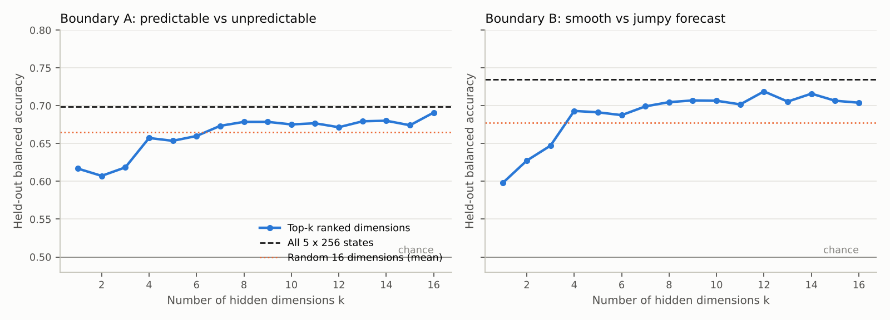
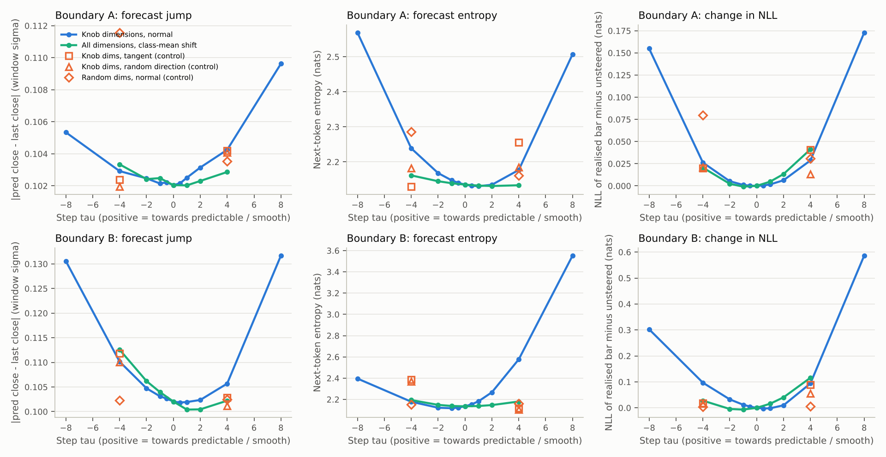
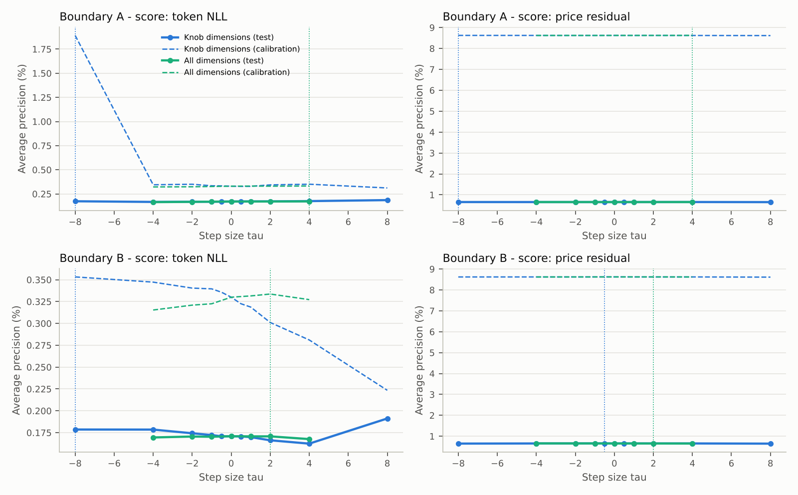

# 用 Knob 调节 Kronos 预测平滑度以改进异常检测 · 实验报告 CN v1

日期:2026-11-24。代码 `knob/`,结果 `results/knob_v1/`,英文版 [knob_smoothness_report_EN_v1.md](knob_smoothness_report_EN_v1.md)。

## 结论

**在本次实验中,转动 Knob 没有改进异常检测;真正限制检测效果的是残差的归一化方式,而不是预测的平滑度。**

1. **Kronos-mini 里没有紧凑的旋钮。** 边界探针的留出平衡准确率只有 69.8%(可预测性)和 73.5%(平滑度)。按论文方法选出的 16 / 12 个维度达到 69.1% / 71.9%,而随机抽同样多的维度平均也有 66.5% / 67.8%。信息分散在全部 256 维里,不像论文在 LLM 中那样集中在 2 个维度。
2. **旋钮对平滑度的控制很弱,而且不特异。** 沿法向走一步,预测跳变幅度的变化在 ±0.03 个窗口标准差以内;切向和随机方向的对照产生了同样大小的变化。步长一大,预测分布先被破坏(熵上升、NLL 变差)。
3. **检测效果不随旋钮变化。** 价格残差分数的测试 AP 在所有步长下都是 0.65%–0.66%;用校准期选出的步长,AP 增益的 95% 区间全部跨零。
4. **原因:预测本身没有贡献。** 把 Kronos 的预测换成"上一根 K 线"(不用模型),检测效果相同(AP 11.6% 对 11.0%,差值区间 [−9.4, +2.3] 个百分点)。既然预测不起作用,调节预测的平滑度自然也不起作用。
5. **有效的杠杆是尺度下限。** 残差除以"窗口标准差 + c"而不是纯标准差,测试 AP 从 0.65% 升到 11.0%(增益区间 [+4.7, +38.8] 个百分点),0.1% 误报率下的召回从 1.6% 升到 59.4%。

## 实验设置

- **模型**:Kronos-mini(4 层,256 维)+ Kronos-Tokenizer-2k,权重 SHA256 与仓库记录一致。回看 64 根 K 线,单步预测,温度 0.6、top-p 0.9、每窗口 6 次采样取平均。
- **数据**:Xu & Livshits 小时级 OHLCVA,921 个币种×交易所序列,与 `xu_pump_1h` 任务相同的时间划分。标签为 PumpOlymp 拉盘信号所在小时。
- **抽样**:校准期全部 62 个拉盘小时 + 15,000 个其他小时;测试期全部 64 个拉盘小时 + 30,000 个其他小时。其他小时按逆抽样概率加权,指标估计的是自然比例(正例率约 0.0087%)。拉盘前后 ±2 小时不作为负例。
- **价格缩放**:行情以 BTC 计价(约 1e-7),直接套用官方的 `std + 1e-5` 归一化会把价格压平,所以先除以窗口平均收盘价。
- **细微异常**:拉盘小时自身高低价差低于拉盘中位数的那一半(测试期 32 个)。

## 方法:把论文的旋钮搬到 Kronos

对应 Huang、Mao、Jiang、Cambria《Uncovering the Knowledge Boundaries and Mechanistic "Knob" of LLMs》的四步:

| 步骤 | 论文(LLM) | 本实验(Kronos) |
| --- | --- | --- |
| 隐藏状态 | 最后一个提示 token,全部层 | 最后一个上下文 token,嵌入输出 + 4 层,共 5×256 |
| 边界标签 | 答对 / 答错 | 无标签:训练期 20,000 个窗口上某个量的最低 / 最高三分位 |
| 选维度 | 按类均值差 Σ\|ΔA\| 排序,取达到全量探针 −1% 的最小 Top-k | 相同 |
| 干预 | 沿打分函数梯度(法向)平移,最小范数分配到各层 | 相同,步长 τ ∈ {±0.5, ±1, ±2, ±4, ±8} |

做了两套边界:

- **边界 A(可预测性)**:真实下一根 K 线的 token NLL 低 / 高,对应论文的"知道 / 不知道"。
- **边界 B(平滑度)**:预测收盘价相对上一收盘价的跳变小 / 大,直接对应"拟合平滑度"。

与论文的差异:全量探针用逻辑回归代替多视角 CNN;蒸馏打分函数用 8 个隐单元的 tanh MLP 代替 KAN。

对照组:旋钮维度上的切向和随机方向;随机维度上的法向;以及不选维度、在最后一层沿类均值差平移全部 256 维(τ=4 等于两类均值之差)。

补丁只改最后一个 token。Kronos 的注意力全部是因果的,所以每个窗口只做一次完整前向,其余 44 个变体只重算一个位置;该实现与完整前向逐元素一致(误差 < 2e-6)。

## 结果

### 1. 旋钮识别



| 边界 | 全量探针 | Top-k(k) | 同样多的随机维度(均值 / 最大) | 层权重集中在 |
| --- | ---: | ---: | ---: | --- |
| A 可预测性 | 69.8% | 69.1%(16) | 66.5% / 68.3% | 最后一层(99%) |
| B 平滑度 | 73.5% | 71.9%(12,未达到 −1% 门槛) | 67.8% / 70.7% | 最后一层 76%,第 2 层 22% |

留出集 2,676 个窗口,机会水平 50%。论文在 Qwen3-8B 上用 2 个维度达到 80.4%,随机 2 维只有 70.0%;这里的差距只有 2–4 个百分点。

### 2. 旋钮对预测的影响



校准期非拉盘小时上的均值(未干预:跳变 0.1020,熵 2.135):

| 变体(边界 B) | 跳变(窗口 σ) | 熵 | NLL 变化 |
| --- | ---: | ---: | ---: |
| 旋钮法向 τ=−4(更粗糙) | 0.1101 | 2.178 | +0.097 |
| 旋钮法向 τ=+1(更平滑) | 0.1019 | 2.182 | −0.002 |
| 旋钮法向 τ=+4 | 0.1057 | 2.577 | +0.094 |
| 旋钮法向 τ=+8 | 0.1317 | 3.552 | +0.586 |
| 对照:切向 τ=−4 | 0.1118 | 2.388 | +0.018 |
| 对照:随机方向 τ=−4 | 0.1100 | 2.367 | +0.017 |
| 全维度均值差 τ=+1 | 0.1004 | 2.138 | +0.016 |

- 往"粗糙"方向能把跳变加大约 8%,但切向和随机方向做到了同样的事,所以这不是法向特有的效果。
- 往"平滑"方向几乎走不动:最多降低 1.6%(全维度平移),再大就把分布推坏。Kronos 的单步预测本来就贴近上一收盘价,没有更平滑的余地。
- 整条曲线不单调(τ 与跳变的秩相关:旋钮 −0.18,全维度 −0.75)。

### 3. 旋钮对检测的影响



步长在校准期按 AP 选定,下表为测试期。

| 分数 | 方法 | 选中 τ | AP 未干预 → 干预 | AP 增益 95% 区间(百分点) | 1% 误报召回 | 细微异常漏检率 |
| --- | --- | ---: | ---: | ---: | ---: | ---: |
| 价格残差 | A 旋钮 | −8 | 0.653% → 0.655% | [−0.006, +0.011] | 75.0% → 75.0% | 50.0% → 50.0% |
| 价格残差 | B 旋钮 | −0.5 | 0.653% → 0.654% | [−0.002, +0.004] | 75.0% → 75.0% | 50.0% → 50.0% |
| 价格残差 | B 全维度 | +2 | 0.653% → 0.653% | [−0.004, +0.003] | 75.0% → 75.0% | 50.0% → 50.0% |
| token NLL | A 旋钮 | −8 | 0.171% → 0.174% | [−0.029, +0.093] | 26.6% → 23.4% | 81.3% → 81.3% |
| token NLL | B 旋钮 | −8 | 0.171% → 0.179% | [−0.059, +0.046] | 26.6% → 32.8% | 81.3% → 71.9% |

唯一看得见的变化是最后一行:NLL 分数在 B 旋钮 τ=−8 下多检出 4 个拉盘,其中 3 个属于细微异常。但 AP 区间跨零,而且 NLL 本身是较弱的分数(未干预时 1% 误报召回 26.6%,价格残差是 75.0%),不能据此声称改进。

### 4. 为什么旋钮帮不上忙

| 分数(测试期) | AP | AUROC | 1% 误报召回 | 0.1% 误报召回 | 细微异常漏检率 |
| --- | ---: | ---: | ---: | ---: | ---: |
| 规则:小时高低价差 | 14.20% | 93.1% | 82.8% | 57.8% | 34.4% |
| Kronos 价格残差(原定义) | 0.65% | 93.2% | 75.0% | 1.6% | 50.0% |
| Kronos 价格残差,尺度下限 c=0.3 | 11.04% | 92.5% | 79.7% | 59.4% | 40.6% |
| 上一根 K 线残差(不用模型),c=0.3 | 11.60% | 92.9% | 78.1% | 57.8% | 43.8% |
| Kronos token NLL | 0.17% | 89.4% | 26.6% | 4.7% | 81.3% |

- **预测不起作用。** Kronos 与"上一根 K 线"的 AP 差值区间是 [−9.4, +2.3] 个百分点。拉盘小时的偏差远大于任何预测之间的差别,排序由真实值决定。
- **归一化在伤害检测。** 原定义把误差除以窗口标准差。这批序列 64% 的小时没有成交,很多窗口标准差接近零,于是冷清行情里的一次普通跳价被放大成极端分数,挤占了排序最靠前的位置。0.1% 误报召回只有 1.6% 就是这个原因。
- **尺度下限直接修掉了它。** c 在校准期从 {0, 0.001, …, 0.3} 中选,选中的是网格上限 0.3,说明越接近"相对价格误差的绝对大小"越好;更大的 c 没有测试。

## 局限

- 只有一个数据集、一个模型规模(mini)、一个回看长度(64),测试期只有 64 个拉盘小时,区间很宽。
- 负例是抽样后加权的,不是全量 73.7 万小时。0.1% 误报阈值只由约 30 个抽样负例决定。
- τ 和 c 的选择用了校准期标签。
- "细微异常"按高低价差定义,与价差规则相关,对该规则偏不利。
- 另试过把旋钮读数当作"预期意外程度"去校正 NLL,在校准期没有帮助,未在测试期评估。
- 结论针对"单步预测 + 最后 token 干预"。多步预测、其他层位或微调后的模型可能不同。

## 复现

```bash
python -m knob.run --klines klines_1h.csv.gz --weights weights --output .local_data/knob_v1
python -m knob.diagnose --klines klines_1h.csv.gz --weights weights --output .local_data/knob_v1
python -m knob.report --runs .local_data/knob_v1 --output results/knob_v1
python -m knob.floor --klines klines_1h.csv.gz --runs .local_data/knob_v1 --output results/knob_v1
python -m knob.plot --results results/knob_v1
python -m pytest tests/test_knob.py -q
```

`klines_1h.csv.gz` 由 `Financial_unsuperviesdAD` 仓库 `claude/ohlcva-experiments` 分支的 `scripts/prepare_ohlcva_klines.py` 生成;权重在本仓库 `weights` 分支。2 核 CPU 上主实验约 80 分钟。全部数字见 `results/knob_v1/results.json` 与 `scale_floor.json`。
