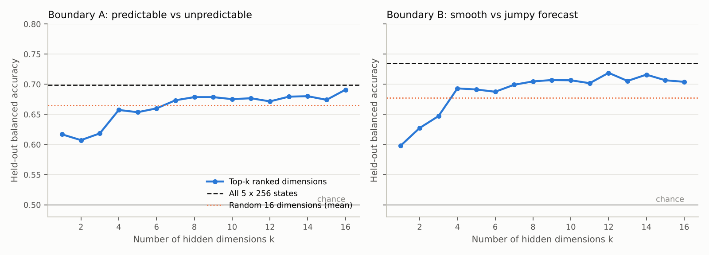
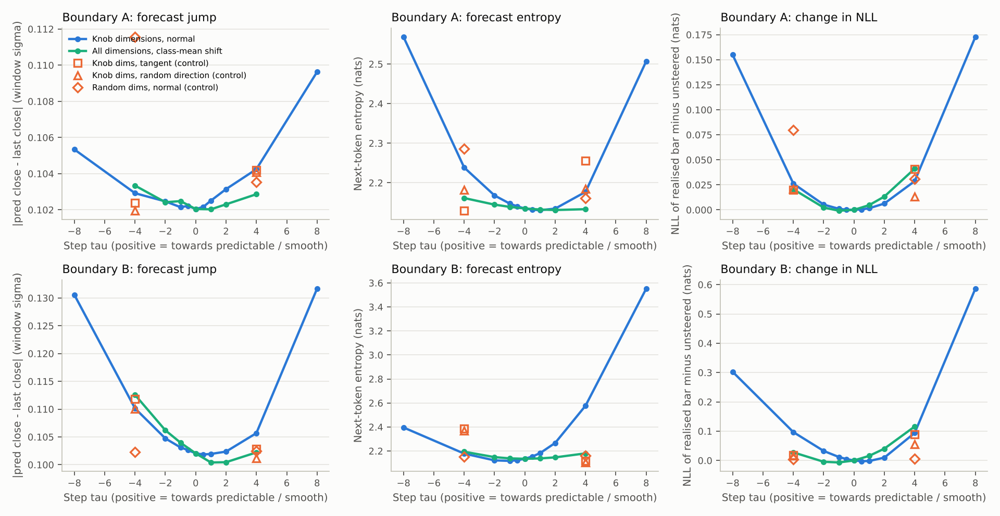
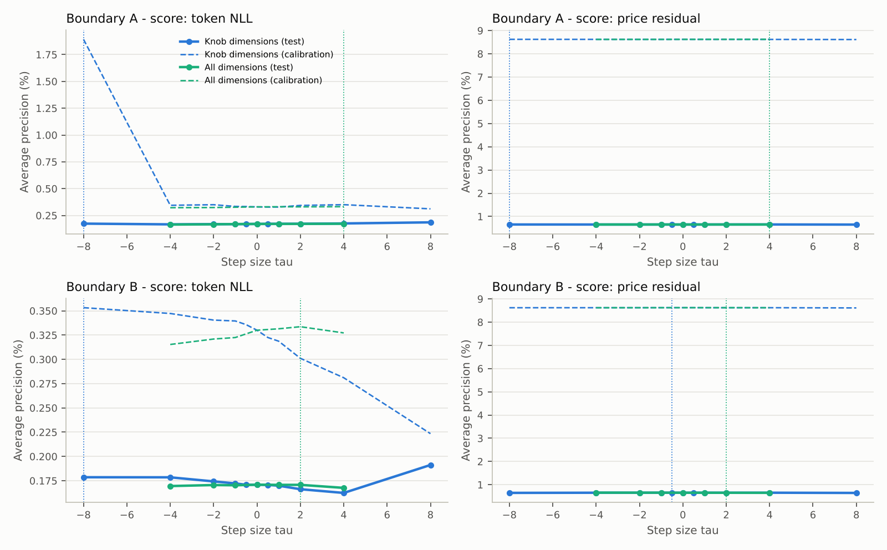

# Steering Kronos forecast smoothness with a Knob for anomaly detection · Report EN v2

Date: 2026-11-24. Code in `knob/`, results in `results/knob_v1/`, Chinese version: [knob_smoothness_report_CN_v2.md](knob_smoothness_report_CN_v2.md).

Changes from v1: new section 5, "Score-side improvements"; the previous-bar comparison now uses the unclipped previous bar, correcting 11.6% to 10.6%; the scale-floor grid was extended.

## Conclusions

**In this experiment, turning the Knob did not improve anomaly detection. Detection is limited by how the residual is normalised, not by how smooth the forecast is.**

1. **Kronos-mini has no compact knob.** The boundary probes reach only 69.8% (predictability) and 73.5% (smoothness) held-out balanced accuracy. The 16 / 12 dimensions selected by the paper's procedure reach 69.1% / 71.9%, while the same number of random dimensions averages 66.5% / 67.8%. The signal is spread over all 256 dimensions rather than concentrated in two, as the paper found in LLMs.
2. **The knob controls smoothness weakly and not specifically.** A step along the normal changes the forecast jump by at most ±0.03 window standard deviations, and tangent and random-direction controls produce changes of the same size. Larger steps break the predictive distribution first (entropy rises, NLL worsens).
3. **Detection does not respond to the knob.** Test AP of the price-residual score stays at 0.65%–0.66% for every step size; with the step chosen on the calibration period, every 95% interval of the AP gain spans zero.
4. **Reason: the forecast contributes nothing.** Replacing the Kronos forecast with the previous bar (no model) detects equally well (AP 10.6% vs 11.0% with the same scale floor; over the full pipeline the difference has interval [−12.1, +27.2] points). If the forecast does not matter, its smoothness cannot either.
5. **The lever that works is a scale floor.** Dividing the residual by "window sigma + c" instead of sigma alone raises test AP from 0.65% to 11.0% (gain interval [+4.7, +38.8] points) and recall at 0.1% false positives from 1.6% to 59.4%.
6. **Scoring price and volume separately and combining them raises AP further to 15.6%.** The miss rate on subtle anomalies falls to 28.1%, below the range rule's 34.4% for the first time; the interval of this step's gain just spans zero, and the difference from the rule is not significant. Cross-sectional detrending does not help.

## Setup

- **Model**: Kronos-mini (4 layers, 256 dims) with Kronos-Tokenizer-2k; weight SHA256 matches the hashes recorded in this repository. Lookback 64 bars, one-step forecast, temperature 0.6, top-p 0.9, mean of 6 samples per window.
- **Data**: Xu & Livshits hourly OHLCVA candles, 921 coin×exchange series, same chronological split as the `xu_pump_1h` task. A label marks the hour of a PumpOlymp pump signal.
- **Sampling**: all 62 calibration pump hours plus 15,000 other hours; all 64 test pump hours plus 30,000 other hours. Other hours carry inverse-probability weights, so metrics estimate the natural ratio (prevalence about 0.0087%). Hours within ±2 bars of a pump are not used as negatives.
- **Price scaling**: prices are quoted in BTC (about 1e-7); the official `std + 1e-5` normalisation would flatten them, so each window is first divided by its mean close.
- **Subtle anomalies**: the half of pump hours whose own high/low range is below the pump median (32 in the test period).

## Method: transferring the paper's knob to Kronos

Following the four steps of Huang, Mao, Jiang and Cambria, "Uncovering the Knowledge Boundaries and Mechanistic 'Knob' of LLMs":

| Step | Paper (LLM) | Here (Kronos) |
| --- | --- | --- |
| Hidden states | last prompt token, all layers | last context token, embedding output + 4 blocks, 5×256 |
| Boundary label | correct / incorrect answer | label-free: lowest / highest tercile of a quantity over 20,000 training-period windows |
| Dimension selection | rank by class-mean difference Σ\|ΔA\|, smallest Top-k within 1% of the full probe | same |
| Intervention | shift along the score gradient (normal), minimum-norm split over layers | same, step τ ∈ {±0.5, ±1, ±2, ±4, ±8} |

Two boundaries were built:

- **Boundary A (predictability)**: low / high token NLL of the realised next bar, the analogue of "knows / does not know".
- **Boundary B (smoothness)**: small / large jump of the forecast close from the last close, the direct analogue of "smoothness of the fit".

Differences from the paper: the full-state probe is logistic regression rather than a multi-view CNN; the distilled score function is a tanh MLP with 8 hidden units rather than a KAN.

Controls: tangent and random directions on the knob dimensions; the normal direction on random dimensions; and, without dimension selection, a shift of all 256 final-layer dimensions along the class-mean difference (τ=4 equals the full gap).

A patch only touches the last token. All attention in Kronos is causal, so each window gets one full forward pass and the other 44 variants recompute a single position; this matches the full forward element-wise (error < 2e-6).

## Results

### 1. Knob identification



| Boundary | Full probe | Top-k (k) | Same number of random dims (mean / max) | Layer weight concentrated in |
| --- | ---: | ---: | ---: | --- |
| A predictability | 69.8% | 69.1% (16) | 66.5% / 68.3% | final layer (99%) |
| B smoothness | 73.5% | 71.9% (12, the 1% criterion was not met) | 67.8% / 70.7% | final layer 76%, layer 2 22% |

Held-out set of 2,676 windows; chance is 50%. The paper reports 80.4% with 2 dimensions on Qwen3-8B against 70.0% for random pairs; here the margin is 2–4 points.

### 2. Effect of the knob on forecasts



Means over non-pump calibration hours (unsteered: jump 0.1020, entropy 2.135):

| Variant (boundary B) | Jump (window σ) | Entropy | NLL change |
| --- | ---: | ---: | ---: |
| Knob normal τ=−4 (rougher) | 0.1101 | 2.178 | +0.097 |
| Knob normal τ=+1 (smoother) | 0.1019 | 2.182 | −0.002 |
| Knob normal τ=+4 | 0.1057 | 2.577 | +0.094 |
| Knob normal τ=+8 | 0.1317 | 3.552 | +0.586 |
| Control: tangent τ=−4 | 0.1118 | 2.388 | +0.018 |
| Control: random direction τ=−4 | 0.1100 | 2.367 | +0.017 |
| All-dimension mean shift τ=+1 | 0.1004 | 2.138 | +0.016 |

- Towards "rough", the jump grows by about 8%, but the tangent and random directions do the same, so the effect is not specific to the normal.
- Towards "smooth" there is almost no room: at most −1.6% (all-dimension shift) before the distribution degrades. One-step Kronos forecasts already sit close to the last close.
- The curve is not monotone (rank correlation of τ with jump: knob −0.18, all dimensions −0.75).

### 3. Effect of the knob on detection



Step sizes were chosen by calibration-period AP; the table shows the test period.

| Score | Method | Chosen τ | AP unsteered → steered | 95% interval of AP gain (points) | Recall at 1% FPR | Miss rate on subtle anomalies |
| --- | --- | ---: | ---: | ---: | ---: | ---: |
| Price residual | A knob | −8 | 0.653% → 0.655% | [−0.006, +0.011] | 75.0% → 75.0% | 50.0% → 50.0% |
| Price residual | B knob | −0.5 | 0.653% → 0.654% | [−0.002, +0.004] | 75.0% → 75.0% | 50.0% → 50.0% |
| Price residual | B all dims | +2 | 0.653% → 0.653% | [−0.004, +0.003] | 75.0% → 75.0% | 50.0% → 50.0% |
| Token NLL | A knob | −8 | 0.171% → 0.174% | [−0.029, +0.093] | 26.6% → 23.4% | 81.3% → 81.3% |
| Token NLL | B knob | −8 | 0.171% → 0.179% | [−0.059, +0.046] | 26.6% → 32.8% | 81.3% → 71.9% |

The only visible change is the last row: with the B knob at τ=−8 the NLL score finds 4 more pumps, 3 of them subtle. The AP interval spans zero and NLL is the weaker score to begin with (26.6% recall at 1% FPR unsteered against 75.0% for the price residual), so this is not evidence of an improvement.

### 4. Why the knob cannot help

| Score (test period) | AP | AUROC | Recall at 1% FPR | Recall at 0.1% FPR | Miss rate on subtle anomalies |
| --- | ---: | ---: | ---: | ---: | ---: |
| Rule: hourly high/low range | 14.20% | 93.1% | 82.8% | 57.8% | 34.4% |
| Kronos price residual (original definition) | 0.65% | 93.2% | 75.0% | 1.6% | 50.0% |
| Kronos price residual, scale floor c=0.3 | 11.04% | 92.5% | 79.7% | 59.4% | 40.6% |
| Previous-bar residual (no model), c=0.3 | 10.64% | 92.4% | 78.1% | 56.3% | 43.8% |
| Kronos token NLL | 0.17% | 89.4% | 26.6% | 4.7% | 81.3% |

- **The forecast does not matter.** The two differ by 0.4 AP points (section 5 gives the interval over the full pipeline). A pump hour deviates far more than any two forecasts differ, so the ranking is set by the realised bar.
- **The normalisation hurts.** The original score divides the error by the window standard deviation. 64% of hours in these series have no trades, many windows have near-zero sigma, and an ordinary tick in a quiet market becomes an extreme score that occupies the top of the ranking. That is why recall at 0.1% FPR is only 1.6%.
- **A scale floor removes it.** c was chosen on the calibration period from {0, 0.001, …, 0.3}; 0.3 won; section 5 extends the grid to larger values and 0.3 is still chosen.

## 5. Score-side improvements (new in v2)

Three changes aimed at the weaknesses found above, all applied to the saved forecasts without running the model again. Every choice was made by calibration-period AP; the table shows the test period.

| Stage (Kronos forecast) | Chosen on calibration | AP | Recall at 1% FPR | Recall at 0.1% FPR | Miss rate on subtle anomalies |
| --- | --- | ---: | ---: | ---: | ---: |
| Original definition | — | 0.65% | 75.0% | 1.6% | 50.0% |
| (1) Scale floor | window sigma + 0.3 | 11.04% | 79.7% | 59.4% | 40.6% |
| (2) Plus cross-sectional detrending | coefficient 0 (not used) | 11.04% | 79.7% | 59.4% | 40.6% |
| Traded amount only | floor 0.01 BTC | 8.30% | 76.6% | 60.9% | 43.8% |
| (3) Price and amount scored separately, then combined | 0.75×price + 0.25×amount | 15.61% | 85.9% | 65.6% | 28.1% |
| Reference: high/low range rule | — | 14.20% | 82.8% | 57.8% | 34.4% |

- **The scale floor works, and 0.3 is an interior optimum.** The grid now extends to 1, 3 and "no division by sigma at all"; calibration still picks 0.3, and a per-series scale from training-period volatility was not selected. The AP gain over the original definition has interval [+4.7, +38.8] points.
- **Cross-sectional detrending does not help.** Three same-hour market indices were tried (mean range, 90th-percentile range, mean range of series that traded); calibration chose coefficient 0. The market does not move with these pumps, so there is nothing to remove.
- **Scoring price and volume separately helps, with weak evidence.** AP rises from 11.0% to 15.6% and the miss rate on subtle anomalies falls from 40.6% to 28.1% (4 more of 32 found), below the range rule's 34.4% for the first time. The AP gain over the scale floor alone has interval [−0.8, +20.0] points, which just spans zero.
- **Still no significant difference from the range rule.** The final score is 1.4 AP points above the rule, with interval [−7.3, +33.2].
- **The model's contribution is still not visible.** The same pipeline with the previous bar in place of the Kronos forecast ends at 13.9% AP and a 31.3% subtle miss rate; the difference has interval [−12.1, +27.2] points.

43 scoring configurations were compared in total, all selected with 62 calibration pump hours; calibration AP (44.5%) is far above test AP (15.6%), so the two periods differ a lot and the selection carries real chance.

## Limitations

- One dataset, one model size (mini), one lookback (64), and only 64 test pump hours; intervals are wide.
- Negatives are sampled and reweighted, not the full 737k hours. The 0.1% FPR threshold rests on about 30 sampled negatives.
- τ and c were chosen with calibration-period labels.
- "Subtle" is defined by the high/low range, which correlates with the range rule and works against that rule.
- Using the knob readout as an "expected surprise" correction for NLL was also tried; it did not help on the calibration period and was not evaluated on test.
- The conclusions concern one-step forecasts with last-token interventions. Multi-step forecasts, other positions, or a fine-tuned model may behave differently.

## Reproduction

```bash
python -m knob.run --klines klines_1h.csv.gz --weights weights --output .local_data/knob_v1
python -m knob.diagnose --klines klines_1h.csv.gz --weights weights --output .local_data/knob_v1
python -m knob.report --runs .local_data/knob_v1 --output results/knob_v1
python -m knob.floor --klines klines_1h.csv.gz --runs .local_data/knob_v1 --output results/knob_v1
python -m knob.improve --klines klines_1h.csv.gz --runs .local_data/knob_v1 --output results/knob_v1
python -m knob.plot --results results/knob_v1
python -m pytest tests/test_knob.py -q
```

`klines_1h.csv.gz` is built by `scripts/prepare_ohlcva_klines.py` on the `claude/ohlcva-experiments` branch of `Financial_unsuperviesdAD`; weights are on this repository's `weights` branch. The main experiment takes about 80 minutes on 2 CPU cores. All numbers are in `results/knob_v1/results.json`, `scale_floor.json` and `score_improvements.json`.
