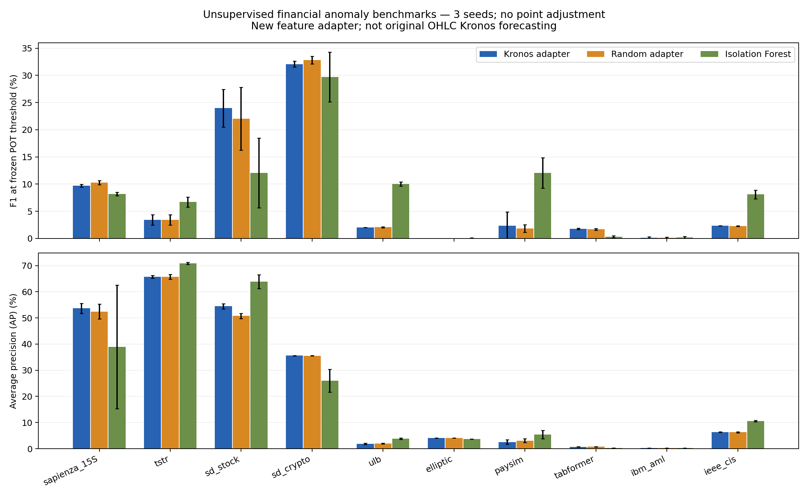

# 无监督金融异常检测实验结果 v1

完成 **10 个任务配置、3 种方法、每种 3 个种子，共 90 次真实运行**。9 组数据均已覆盖；SD-FMM 分 stock/crypto 两个任务。Sapienza 本轮使用 15S，同事件的 5S/25S 不作独立数据集重复汇总。

**结论必须按数据集看。以下 Kronos 成绩来自新加入的特征自编码适配器，不是原版 OHLC 预测误差检测器。单 token 骨干不建模跨时间注意力；本轮验证的是无标签特征重构迁移。**

本轮**未显示预训练权重相对随机骨干的稳定收益**。固定 POT 阈值下，适配器在部分市场操纵任务的 F1 高于 Isolation Forest，但在 ULB、PaySim、IEEE-CIS 上低于它；Elliptic 和 AML 的检测效果很弱。SD-FMM stock 的适配器 F1 虽高于 Isolation Forest，AP 却更低，因此也不能据此声称排序能力全面更好。这是训练上限 5 万条、固定 400 步的初步对照，尚不能作为方法优越性的结论。

以 Sapienza 为例，适配器 Recall 达 96.54%、ROC-AUC 达 99.87%，但 Precision 仅 5.11%、F1 为 9.70%。这说明高召回和高 ROC-AUC 仍可能伴随大量误报，应联合查看 AP、Precision 和 FPR。

训练与 POT 校准不访问标签，全部测试记录保留自然类别比例。每个种子最多均匀抽取 50,000 个训练样本、100,000 个校准样本；测试不抽样。阈值使用固定 POT（q=0.85，risk=0.01，min_peaks=20），不是根据测试 F1 选择。训练包含未知异常污染。详见[预先固定的协议](unsupervised_benchmark_protocol_CN.md)。

## Kronos 适配器结果

下列指标均为三个种子的均值，单位 %；F1 同时列出总体标准差。AP 为 Average Precision，梯形 PR-AUC 另存 CSV。Precision/Recall/F1 使用固定 POT 阈值。测试数仅计算有真值的记录。

| 数据/任务 | 有标签测试数（正例） | Precision | Recall | F1 ± std | AP | ROC-AUC | FPR |
| --- | ---: | ---: | ---: | ---: | ---: | ---: | ---: |
| sapienza_15S | 145,550 (77) | 5.11 | 96.54 | 9.70 ± 0.26 | 53.64 | 99.87 | 0.95 |
| tstr | 194 (94) | 55.56 | 1.77 | 3.43 ± 0.95 | 65.72 | 74.41 | 1.33 |
| sd_stock | 960 (99) | 72.15 | 14.48 | 23.96 ± 3.46 | 54.47 | 89.97 | 0.66 |
| sd_crypto | 10,880 (68) | 29.42 | 35.29 | 32.08 ± 0.57 | 35.58 | 97.64 | 0.53 |
| ulb | 92,575 (115) | 1.15 | 8.70 | 2.03 ± 0.01 | 1.91 | 93.12 | 0.93 |
| elliptic | 16,670 (1,083) | 0.00 | 0.00 | 0.00 ± 0.00 | 4.07 | 26.70 | 7.20 |
| paysim | 1,248,736 (4,250) | 1.66 | 3.96 | 2.34 ± 2.55 | 2.57 | 85.83 | 0.75 |
| tabformer | 3,782,053 (4,578) | 0.98 | 9.03 | 1.76 ± 0.11 | 0.69 | 86.26 | 1.09 |
| ibm_aml | 1,015,564 (1,797) | 0.09 | 0.43 | 0.14 ± 0.16 | 0.23 | 55.13 | 0.71 |
| ieee_cis | 105,693 (3,611) | 3.74 | 1.71 | 2.34 ± 0.02 | 6.31 | 69.87 | 1.56 |

## 同协议对照

表中为 F1 / AP（%，三种子均值）。随机适配器与 Kronos 适配器的输入/输出层初始化和训练样本一致；随机骨干也保持冻结。未进行显著性检验，不以少量百分点差异声称预训练优势。

| 数据/任务 | Kronos 适配器 | Isolation Forest | 随机骨干适配器 |
| --- | ---: | ---: | ---: |
| sapienza_15S | 9.70 / 53.64 | 8.18 / 38.98 | 10.29 / 52.44 |
| tstr | 3.43 / 65.72 | 6.71 / 70.87 | 3.42 / 65.70 |
| sd_stock | 23.96 / 54.47 | 12.05 / 63.85 | 22.03 / 50.76 |
| sd_crypto | 32.08 / 35.58 | 29.69 / 25.97 | 32.82 / 35.55 |
| ulb | 2.03 / 1.91 | 10.02 / 3.86 | 2.07 / 2.01 |
| elliptic | 0.00 / 4.07 | 0.08 / 3.69 | 0.00 / 4.08 |
| paysim | 2.34 / 2.57 | 12.05 / 5.39 | 1.84 / 3.08 |
| tabformer | 1.76 / 0.69 | 0.29 / 0.28 | 1.68 / 0.74 |
| ibm_aml | 0.14 / 0.23 | 0.17 / 0.24 | 0.11 / 0.21 |
| ieee_cis | 2.34 / 6.31 | 8.10 / 10.57 | 2.28 / 6.28 |



## 解释范围与限制

- **检测能力以实测为准。** 异常标签代表欺诈/操纵，统计离群分数不必与其一致。高 ROC-AUC 也可能伴随很低的 Precision/AP；极度不平衡时不可只报告准确率。
- **TSTR 为整段序列级评价**，不是实时点级检测。训练和校准约一半为正，POT 的主要正常假设不成立；不能依据该数据声称稀有异常阈值已经校准。
- **SD-FMM 两个任务为点级评价**，复用出版者已处理的 test 数组重新分组，stock 仅 6 个测试序列；不是原论文基准的独立复现，原全段归一化可能包含未来信息。
- **Sapienza 为作者标注的操纵起点块**，不是完整事件持续区间。不使用 point adjustment、事件补全或邻近容忍窗口，不能与采用这些处理的 F1 直接比较。
- **Elliptic 未知标签不算正常**。未知节点可用于无标签拟合；测试只评价已知合法/非法节点。此处不使用图边，原聚合特征也不能保证因果实时可用。
- **支付数据按时间留出**，并非未见账户留出；PaySim、TabFormer、AML 为合成数据，不能据此承诺真实部署效果。AML/TabFormer 的哈希名义特征只是本轮固定适配，不是完整交易图方法。
- 金额收付、错误标记等字段以完整交易记录为基础，本轮属于离线记录检测，不能自动解读为支付授权前可用的实时拦截效果。数据未给出异常维度真值，不报告维度诊断指标。
- **IEEE-CIS 仅评价官方训练表内的时间留出**，不涉及 Kaggle 官方测试成绩。未接身份表、未针对该竞赛调参；原始数据、训练缓存和逐行输出未上传。
- 一个通用的固定阈值/固定步数配置可能欠拟合或对分布漂移失效。本轮是可复现的初步对照，不是经调参得到的最终性能上限；未跨数据集计算混合平均排名。

## 可核验证据与复现

- 实验代码起点：`c9e28a4a1751a4371f1c2465d001aaa8cbf89586`；适配器设备 `mps`，其余预处理/Isolation Forest/POT 为 CPU；Python 3.12.14，PyTorch 2.6.0，scikit-learn 1.7.2。
- Kronos-mini 权重 SHA256：`a7d5f37e2e9fbd9891f7d7d4f72574512dd1f704fee14223e0a8cd0fbf54197c`。
- 本地权重与 [Hugging Face 固定版本](https://huggingface.co/NeoQuasar/Kronos-mini/tree/f4e68697d9d5aed55cef5c96aabc3376bcad9f81) 的 Git LFS SHA256 一致；[校验记录](../results/unsupervised_v1/weights_provenance.json)。
- [逐种子全部指标与混淆矩阵](../results/unsupervised_v1/metrics.csv) · [均值和标准差](../results/unsupervised_v1/summary.csv) · [完整聚合运行记录、训练损失、POT 参数和评分哈希](../results/unsupervised_v1/runs.json)。
- [各分区样本数、标签组成和特征清单](../results/unsupervised_v1/splits.json) · [依赖、命令和运行环境](../results/unsupervised_v1/environment.json)。
- [独立核验记录](../results/unsupervised_v1/verification.json)：90 次运行的评分 SHA256、混淆矩阵、抽样索引和 POT 峰数均通过复核。本地 47 项测试通过；[核心依赖锁定文件](../results/unsupervised_v1/requirements-lock.txt)用于复现。
- 原始数据依照各自授权保留；本报告只发布聚合证据。模型权重、逐行分数、训练抽样索引及预处理参数保存在本地 `.local_data/unsupervised_runs_v1_full/`，未提交到 Git。

```bash
python -m benchmarks.run --cache .local_data/unsupervised_v1 \
  --output .local_data/unsupervised_runs_v1_full \
  --weights weights/Kronos-mini --device mps
python -m benchmarks.report --runs .local_data/unsupervised_runs_v1_full \
  --cache .local_data/unsupervised_v1 --output results/unsupervised_v1 \
  --document docs/unsupervised_benchmark_results_CN.md
```

其他设备可选 cpu/cuda；硬件差异不保证逐位相同。报告导出目录必须为新目录；训练输出可在同配置下断点续跑，配置不同时应使用另一目录，以保留既有实验。
